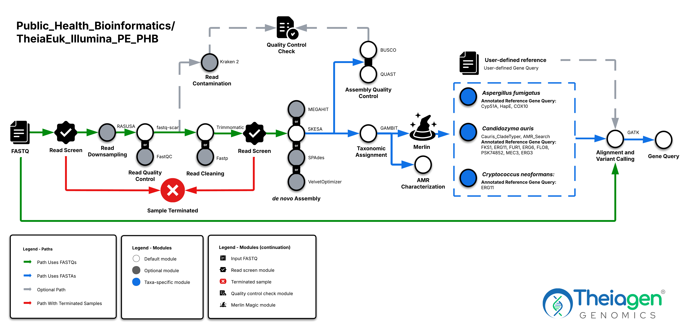
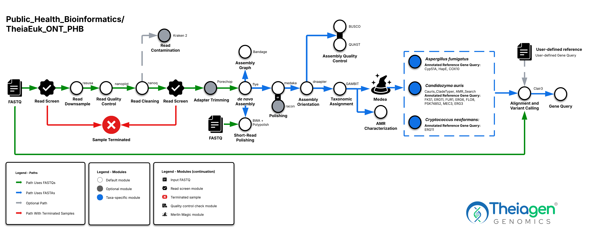

# TheiaEuk™ Workflow Series

## Quick Facts

{{ render_tsv_table("docs/assets/tables/all_workflows.tsv", sort_by="Name", filters={"Name": "[**TheiaEuk Workflow Series**](../workflows/genomic_characterization/theiaeuk.md)"}, columns=["Workflow Type", "Applicable Kingdom", "Last Known Changes", "Command-line Compatibility","Workflow Level", "Dockstore"]) }}

## TheiaEuk Workflows

**The TheiaEuk workflows are for the assembly, quality assessment, and characterization of fungal genomes.** It is designed to accept Illumina paired-end sequencing data or base-called ONT reads as the primary input. It is currently intended only for ==haploid== fungal genomes, like _Candidozyma auris_, due to technical limitations of short-read _de novo_ assembly. Variant calling in TheiaEuk accounts for variable ploidy, but assembling diploid/polyploid genomes using TheiaEuk should be attempted only with expert attention to the resulting genome quality.

All input reads are processed through "core tasks" in each workflow. The core tasks include raw read quality assessment, read cleaning (quality trimming and adapter removal), de novo assembly, assembly quality assessment, species taxon identification, and antimicrobial resistance (AMR) _in silico_ prediction. For some taxa identified, taxa-specific sub-workflows will be automatically activated, undertaking additional taxa-specific characterization steps, including clade-typing and/or antifungal resistance detection.

=== "TheiaEuk_Illumina_PE"

    !!! caption "TheiaEuk Illumina PE Workflow Overview"
        

=== "TheiaEuk_ONT"

    !!! caption "TheiaEuk ONT Workflow Overview"
        

!!! warning "Before running TheiaEuk"

    For some taxa, TheiaEuk performs reference-based variant calling on the cleaned read dataset and then summarizes coverage and variants across genes associated with antifungal resistance (see the [Organism-specific characterization](#organism-specific-characterization) section). TheiaEuk_Illumina_PE aligns reads with `BWA` and calls/filters variants with `GATK` (`gatk_variants` + `gatk_filter`), while TheiaEuk_ONT aligns with `minimap2` and calls variants with `Clair3`.

### Inputs

!!! dna "Input Read Data"
    === "TheiaEuk_Illumina_PE"

        The TheiaEuk_Illumina_PE workflow takes in Illumina paired-end read data. Read file names should end with `.fastq` or `.fq`, with the optional addition of `.gz`. When possible, Theiagen recommends zipping files with [gzip](https://www.gnu.org/software/gzip/) before Terra uploads to minimize data upload time.

        By default, the workflow anticipates **2 x 150bp** reads (i.e. the input reads were generated using a 300-cycle sequencing kit). Modifications to the optional parameter for `trim_minlen` may be required to accommodate shorter read data, such as the 2 x 75bp reads generated using a 150-cycle sequencing kit.

    === "TheiaEuk_ONT"

        The TheiaEuk_ONT workflow takes in base-called ONT read data. Read file names should end with `.fastq` or `.fq`, with the optional addition of `.gz`. When possible, Theiagen recommends zipping files with [gzip](https://www.gnu.org/software/gzip/) before uploading to Terra to minimize data upload time.

        **The ONT sequencing kit and base-calling approach can produce substantial variability in the amount and quality of read data. Genome assemblies produced by the TheiaEuk_ONT workflow must be quality assessed before reporting results.**

!!! caption ""
    === "TheiaEuk_Illumina_PE"
        /// html | div[class="searchable-table"]

        {{ render_tsv_table("docs/assets/tables/all_inputs.tsv", input_table=True, filters={"Workflow": "TheiaEuk_Illumina_PE"}, columns=["Terra Task Name", "Variable", "Type", "Description", "Default Value", "Terra Status"], sort_by=[("Terra Status", True), "Terra Task Name", "Variable"], indent=8) }}
        ///

    === "TheiaEuk_ONT"
        /// html | div[class="searchable-table"]

        {{ render_tsv_table("docs/assets/tables/all_inputs.tsv", input_table=True, filters={"Workflow": "TheiaEuk_ONT"}, columns=["Terra Task Name", "Variable", "Type", "Description", "Default Value", "Terra Status"], sort_by=[("Terra Status", True), "Terra Task Name", "Variable"], indent=8) }}
        ///

### Workflow Tasks

All input reads are processed through "core tasks" in the TheiaEuk workflows. These undertake read trimming and assembly appropriate to the input data type. TheiaEuk workflow subsequently launch default genome characterization modules for quality assessment, and additional taxa-specific characterization steps. When setting up the workflow, users may choose to use "optional tasks" or alternatives to tasks run in the workflow by default.

#### Core tasks

!!! dna ""
    These tasks are performed regardless of organism. They include tasks that are performed regardless of and specific for the input data type. They perform read trimming and assembly appropriate to the input data type.

{{ include_md("common_text/versioning_task.md") }}

!!! caption ""
    === "TheiaEuk_Illumina_PE"
{{ include_md("common_text/read_screen_task.md", condition="theiaeuk", indent=8) }}
{{ include_md("common_text/read_qc_trim_illumina_wf.md", condition="theiaeuk", indent=8) }}
{{ include_md("common_text/qc_check_task.md", condition="theiaeuk", indent=8) }}

        !!! dna ""
            These tasks assemble the reads into a _de novo_ assembly and assess the quality of the assembly.

{{ include_md("common_text/digger_denovo_wf.md", indent=8) }}
{{ include_md("common_text/quast_task.md", indent=8) }}
{{ include_md("common_text/cg_pipeline_task.md", indent=8) }}

    === "TheiaEuk_ONT"
{{ include_md("common_text/read_screen_task.md", condition="theiaeukont", indent=8) }}
{{ include_md("common_text/read_qc_trim_ont_wf.md", condition="theiaeuk", indent=8) }}
{{ include_md("common_text/qc_check_task.md", condition="theiaeuk", indent=8) }}

        !!! dna ""
            These tasks assemble the reads into a _de novo_ assembly and assess the quality of the assembly.
{{ include_md("common_text/flye_denovo_wf.md", condition="theiaeuk", indent=8) }}
{{ include_md("common_text/quast_task.md", indent=8) }}

#### Organism-agnostic characterization

!!! tip ""
    These tasks are performed regardless of the organism and provide quality control and taxonomic assignment.

{{ include_md("common_text/busco_task.md") }}
{{ include_md("common_text/gambit_task.md") }}

#### Organism-specific characterization

!!! tip ""
    The TheiaEuk workflow automatically activates taxa-specific tasks after identification of the relevant taxa using `GAMBIT`. If an `expected_taxon` is provided (e.g., "Candidozyma auris"), it overrides the `GAMBIT` taxonomic assignment. Default taxa (_Candidozyma auris_, _Cryptococcus neoformans_, or _Aspergillus fumigatus_) do not require user input to run characterization modules, and other taxa can undergo reference-based variant calling and gene characterization by inputting a `reference_fasta` and `reference_gff`.

??? toggle "Reference-based variant calling"
    After taxonomic identification, TheiaEuk performs reference-based variant calling whenever a `reference_fasta` is provided or a default organism is selected (user input takes precedence). The resulting variants are summarized with respect to target regions if a `reference_gff` and `query_genes`/`query_genes_bed` are populated; these are populated automatically for default organisms. For _C. auris_, genome-wide reference-based variant calling is reported against a clade-specific reference genome by default, while _C. auris_ antimicrobial resistance (AMR) gene variants are called relative to `cauris_amr_fasta` (the B11205 reference by default). This bifurcation produces a high-quality VCF for downstream phylogenetic analysis and complies with standardized variant reporting respectively. For _C. auris_, `reference_fasta` only replaces the genome-wide reference; the AMR reference is changed with `cauris_amr_fasta` and `cauris_amr_gff`.

    Default values are depicted for default organisms in their respective sections below.

    Two data-type-specific tracks are supported:

    - **Illumina (paired-end):** reads are aligned to the reference with `BWA`, variants are called with `gatk_variants`, and the genotyped GVCF is filtered with `gatk_filter`.
    - **ONT:** reads are aligned with `minimap2` and variants are called and filtered with `Clair3`.

    ??? dna "`reference_fasta` input parameter"
        The reference FASTA used for read alignment and variant calling. A user-supplied `reference_fasta` always takes precedence over the defaults below. When it is not provided, an organism-specific default reference is selected automatically:

        For any other identified organism (e.g. _Candida albicans_), variant calling only runs if `reference_fasta` is supplied by the user.

    ??? dna "`reference_gff` input parameter"
        The annotated reference (General Features Format, GFF) used by the `gene_coverage` and `snpeff_gene_variants` tasks to extract query genes list into genomic coordinates. A user-supplied `reference_gff` always takes precedence over the defaults below. When it is not provided, an organism-specific default is selected automatically if a default organism is identified:

        !!! warning "Keep the FASTA and GFF matched"
            The reference FASTA and GFF must use the same assembly. If a custom `reference_fasta` is provided, an associated `reference_gff` must also be provided (and vice versa).

            If only one of these inputs is provided, gene coverage calculations and gene-centric variant reporting will not run under the assumption there is a discrepancy.

        !!! info "_C. auris_ uses a separate AMR reference"
            For _C. auris_, gene coverage and gene-centric variant reporting always use `cauris_amr_fasta` and `cauris_amr_gff` (B11205 by default) instead, so `reference_gff` is not used and `reference_fasta` only affects genome-wide variant calling (see the _Candidozyma auris_ section below).

    ??? dna "`query_genes` and `query_genes_bed` input parameter"
        `query_genes` is a comma-delimited list of query genes to extract from the `reference_gff` supplied by default/the user. These `query_genes` _must_ correspond to the associated "product" or "locus_tag" field of gene/CDS entries within the `reference_gff`. By default, "FKS1" will match "1,3-beta-D-glucan synthase_complex_FKS1", though exact product matching can be enforced by setting `query_exact_match` to "true".

        !!! warning "Replace ',' in query names with '.'"
            Commas within `query_genes` inputs can be replaced with "." to properly resolve the query name(s).

        !!! warning "`query_exact_match` input parameter"
            `query_exact_match` is set to "false" by default, which enables gene shorthand names to be used when they correspond to entries within the `reference_gff`. However, this can lead to substring matching, where "ERG11" can match entries with the name "ERG112". To prevent this, completely enter the exact product name of desired genes by referencing the GFF.

    === "TheiaEuk_Illumina_PE"
{{ include_md("common_text/bwa_task.md", indent=8, condition="theiaeuk") }}
{{ include_md("common_text/gatk_variants_task.md", indent=8) }}
{{ include_md("common_text/gatk_filter_task.md", indent=8) }}

    === "TheiaEuk_ONT"
{{ include_md("common_text/minimap2_task.md", indent=8, condition="long_read_flags") }}
{{ include_md("common_text/clair3_task.md", indent=8, condition="theiaeuk") }}

{{ include_md("common_text/mapping_stats_task.md", indent=4) }}
{{ include_md("common_text/gene_coverage_task.md", indent=4, condition="theiaeuk") }}
{{ include_md("common_text/snpeff_task.md", indent=4) }}

??? toggle "_Candidozyma auris_ (also known as _Candida auris_)"
    When this species is detected by GAMBIT, clade typing determines the clade the genome belongs to, and AMR detection is conducted. Variant calling is bifurcated: reads are aligned and variants called against two references, each fit for its purpose:

    | Track | Reference | Reported outputs |
    |---|---|---|
    | Genome-wide (phylogenetics) | `reference_fasta` if supplied, otherwise the clade-specific reference selected by `cladetyper` | Genome-wide read alignment, genome-wide VCFs, and reference genome mapping stats |
    | Gene-level AMR | `cauris_amr_fasta` and `cauris_amr_gff` (default: Clade I strain B11205, `GCA_016772135.1`) | `gene_coverage` and `snpeff_gene_variants` only |

    - Genome-wide variant calling with respect to a clade-specific reference increases the quality of downstream phylogenetic analysis
    - Reporting AMR variants with respect to the B11205 reference ensures coordinates are the same for every clade and standardized with the broader field
    - `reference_fasta_used` reports the genome-wide reference, while `reference_gff_used` and `gene_query` report the GFF and query used by the gene-level modules (i.e., `cauris_amr_gff`). A `query_genes_bed` must use `cauris_amr_fasta` coordinates.
    - Default gene query: product IDs for genes with a unique product annotation, plus B11205 locus tags for genes annotated only as "hypothetical protein". A user-supplied `query_genes` takes precedence.

    !!! info "Changing the _C. auris_ references"
        The two tracks are configured independently:

        - `reference_fasta` replaces the clade-specific genome-wide reference only; `reference_gff` is not used for _C. auris_.
        - `cauris_amr_fasta` and `cauris_amr_gff` replace the B11205 AMR reference and its annotation. The default gene query contains B11205-specific locus tags, so a `query_genes` (or `query_genes_bed`) matching a non-default `cauris_amr_gff` must be provided; queries missing from the GFF are reported as not found in `gene_coverage_query_check`.
        - If `cauris_amr_fasta` matches the genome-wide reference (compared by file name), variant calling runs only once and the gene-level modules reuse the genome-wide alignment and VCF with `cauris_amr_gff`. To call all variants against a single reference, provide the same FASTA as both `reference_fasta` and `cauris_amr_fasta`, and its annotation as `cauris_amr_gff`.

    The default gene query is:

    | Gene | Query |
    |---|---|
    | _FKS1_ | `FKS1` |
    | _ERG11_ | `lanosterol.14-alpha.demethylase` |
    | _FUR1_ | `uracil.phosphoribosyltransferase` |
    | _ERG6_ | `sterol.24-C-methyltransferase` |
    | _FLO8_ | `FLO8` |
    | _MEC3_ | `CJI82_01006` |
    | _ERG3_ | `CJI82_00364` |
    | _PSK74852_ | `CJI82_03986` |

    NOTE: Variants derived from locus tag searches will be reported with respect to the locus tag name, not the gene name

{{ include_md("common_text/cauris_cladetyper.md", indent=4) }}
{{ include_md("common_text/amr_search_task.md", indent=4, condition="theiaeuk") }}

??? toggle "_Aspergillus fumigatus_"
    When this species is detected by GAMBIT, reference-based variant calling is performed against the hosted _A. fumigatus_ reference (see the **Reference-based variant calling** section above).

    - Default reference genome and annotation: `GCF_000002655.1` (ASM265v1)
    - Default gene query: locus tags are queried instead of product names to maintain search specificity

        | Gene | Locus tag |
        |---|---|
        | _CYP51A_ | `AFUA_4G06890` |
        | _HAPE_ | `AFUA_6G05300` |
        | _COX10_ | `AFUA_4G08340` |

        NOTE: Variants derived from locus tag searches will be reported with respect to the locus tag name, not the gene name

??? toggle "_Cryptococcus neoformans_"
    When this species is detected by GAMBIT, reference-based variant calling is performed against the hosted _C. neoformans_ reference (see the **Reference-based variant calling** section above).

    - Default reference genome and annotation: `GCF_000091045.1` (ASM9104v1)
    - Default gene query: product IDs are queried

        | Gene | Locus tag |
        |---|---|
        | _ERG11_ | CNA00300 |

### Outputs

!!! caption ""
    === "TheiaEuk_Illumina_PE"
        /// html | div[class="searchable-table"]

        {{ render_tsv_table("docs/assets/tables/all_outputs.tsv", input_table=False, filters={"Workflow": "TheiaEuk_Illumina_PE"}, columns=["Terra Task Name", "Variable", "Type", "Description", "Default Value", "Terra Status"], sort_by=[("Terra Status", True), "Terra Task Name", "Variable"], indent=8) }}
        ///

    === "TheiaEuk_ONT"
        /// html | div[class="searchable-table"]

        {{ render_tsv_table("docs/assets/tables/all_outputs.tsv", input_table=False,  filters={"Workflow": "TheiaEuk_ONT"}, columns=["Terra Task Name", "Variable", "Type", "Description", "Default Value", "Terra Status"], sort_by=[("Terra Status", True), "Terra Task Name", "Variable"], indent=8) }}
        ///

??? info "> v5.0.0 output equivalents for PHB < v4.3.1"
    Snippy-based variant calling was replaced by `BWA` + `GATK` (TheiaEuk_Illumina_PE) and `minimap2` + `Clair3` (TheiaEuk_ONT), with gene-level variant reporting moved to `snpeff_gene_variants`. The following outputs are approximate or direct replacements of their v4.3.1 counterparts.

    | v4.3.1 Output | Current Output | Workflow(s) | Notes |
    |---|---|---|---|
    | `assembler` | `assembler_used` | Illumina_PE | Renamed only |
    | `theiaeuk_snippy_variants_reference_genome` | `reference_fasta_used` | Illumina_PE | Previously a GenBank file; now a FASTA, with its annotation reported in `reference_gff_used`. For _C. auris_, this is the genome-wide reference; gene-level outputs use `cauris_amr_fasta` (B11205 by default) |
    | `theiaeuk_snippy_variants_bam` | `bwa_genome_variants_bam` (Illumina_PE); `minimap2_genome_variants_bam` (ONT) | Both | v4.3.1 TheiaEuk_ONT aligned assembly contigs; cleaned reads are now aligned |
    | `theiaeuk_snippy_variants_bai` | `bwa_genome_variants_bai` (Illumina_PE); `minimap2_genome_variants_bai` (ONT) | Both | See above |
    | `theiaeuk_snippy_variants_results` | `gatk_genome_variants_selected_vcf` (Illumina_PE); `clair3_genome_variants_selected_vcf` (ONT) | Both | Filtered genome-wide variants; previously Snippy's CSV, now a VCF |
    | `theiaeuk_snippy_variants_num_variants` | `genome_mapping_total_snps` | Both | Now counts unique SNP sites that pass filtering; indels, MNPs, and complex variants are no longer counted |
    | `theiaeuk_snippy_variants_coverage_tsv` | `genome_mapping_cov_stats` | Both | Same format |
    | `theiaeuk_snippy_variants_percent_ref_coverage` | `genome_mapping_percent_coverage` | Both | Same format |
    | `theiaeuk_snippy_variants_query` | `gene_query` | Both | The _C. auris_ default query now uses B11205 locus tags |
    | `theiaeuk_snippy_variants_query_check` | `gene_coverage_query_check` | Both | Same format; a PASS/FAIL summary is reported in `gene_coverage_query_check_status` |
    | `theiaeuk_snippy_variants_hits` | `snpeff_gene_variants_hits` | Both | Similar format; synonymous variants are suppressed by default (see `suppressed_variants`). A condensed form is reported in `snpeff_gene_variants_hits_abbreviated` |
    | `theiaeuk_snippy_variants_gene_query_results` | `snpeff_gene_variants_report_tsv` | Both | Previously Snippy's CSV rows for queried genes; now a gene-labelled TSV of SnpEff annotations |
    | `theiaeuk_snippy_variants_num_reads_aligned` | `genome_mapping_percentage_mapped_reads` | Both | Previously a raw number of reads aligned, now it is a percent of the total cleaned reads |
    | `gene_coverage_percent_coverage_by_gene` | `gene_coverage_breadth_by_gene` | Illumina_PE | Renamed |
