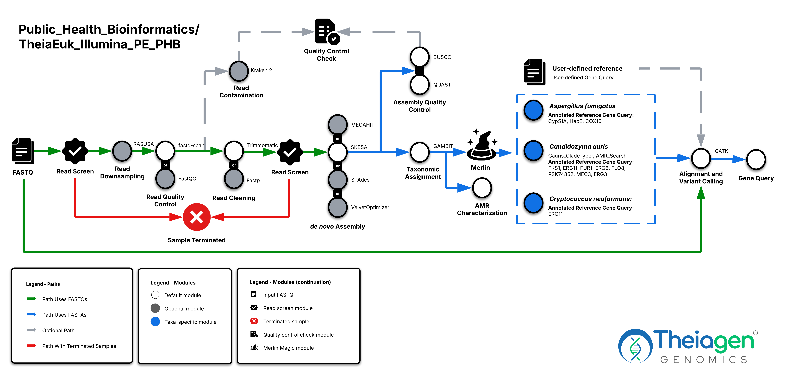
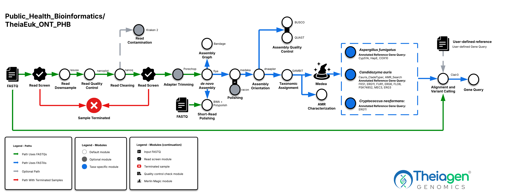

# TheiaEuk™ Workflow Series

## Quick Facts

{{ render_tsv_table("docs/assets/tables/all_workflows.tsv", sort_by="Name", filters={"Name": "[**TheiaEuk Workflow Series**](../workflows/genomic_characterization/theiaeuk.md)"}, columns=["Workflow Type", "Applicable Kingdom", "Last Known Changes", "Command-line Compatibility","Workflow Level", "Dockstore"]) }}

## TheiaEuk Workflows

**The TheiaEuk workflows are for the assembly, quality assessment, and characterization of fungal genomes.** It is designed to accept Illumina paired-end sequencing data or base-called ONT reads as the primary input. **It is currently intended only for ==haploid== fungal genomes like _Candidozyma auris_.** Analyzing diploid genomes using TheiaEuk should be attempted only with expert attention to the resulting genome quality.

All input reads are processed through "core tasks" in each workflow. The core tasks include raw read quality assessment, read cleaning (quality trimming and adapter removal), de novo assembly, assembly quality assessment, species taxon identification, and antimicrobial resistance (AMR) _in silico_ prediction. For some taxa identified, taxa-specific sub-workflows will be automatically activated, undertaking additional taxa-specific characterization steps, including clade-typing and/or antifungal resistance detection.

=== "TheiaEuk_Illumina_PE"

    !!! caption "TheiaEuk Illumina PE Workflow Overview"
        

=== "TheiaEuk_ONT"

    !!! caption "TheiaEuk ONT Workflow Overview"
        

!!! warning "Before running TheiaEuk"

    For some taxa, TheiaEuk_Illumina_PE relies on [Snippy](#organism-specific-characterization) to perform variant calling on the cleaned read dataset and then queries the resulting file for specific mutations that are known to confirm antifungal resistance (see [Organism-specific characterization](#organism-specific-characterization) section). This behavior has been replicated in TheiaEuk_ONT but the variant calling is performed directly on the resulting assemblies. Therefore, the read support reported is, at the moment, non-reliable. Future improvements will include improvements on this module.

### Inputs

!!! dna "Input Read Data"
    === "TheiaEuk_Illumina_PE"

        The TheiaEuk_Illumina_PE workflow takes in Illumina paired-end read data. Read file names should end with `.fastq` or `.fq`, with the optional addition of `.gz`. When possible, Theiagen recommends zipping files with [gzip](https://www.gnu.org/software/gzip/) before Terra uploads to minimize data upload time.

        By default, the workflow anticipates **2 x 150bp** reads (i.e. the input reads were generated using a 300-cycle sequencing kit). Modifications to the optional parameter for `trim_minlen` may be required to accommodate shorter read data, such as the 2 x 75bp reads generated using a 150-cycle sequencing kit.

    === "TheiaEuk_ONT"

        The TheiaEuk_ONT workflow takes in base-called ONT read data. Read file names should end with `.fastq` or `.fq`, with the optional addition of `.gz`. When possible, Theiagen recommends zipping files with [gzip](https://www.gnu.org/software/gzip/) before uploading to Terra to minimize data upload time.

        **The ONT sequencing kit and base-calling approach can produce substantial variability in the amount and quality of read data. Genome assemblies produced by the TheiaEuk_ONT workflow must be quality assessed before reporting results.**

!!! caption ""
    === "TheiaEuk_Illumina_PE"
        /// html | div[class="searchable-table"]

        {{ render_tsv_table("docs/assets/tables/all_inputs.tsv", input_table=True, filters={"Workflow": "TheiaEuk_Illumina_PE"}, columns=["Terra Task Name", "Variable", "Type", "Description", "Default Value", "Terra Status"], sort_by=[("Terra Status", True), "Terra Task Name", "Variable"], indent=8) }}
        ///

    === "TheiaEuk_ONT"
        /// html | div[class="searchable-table"]

        {{ render_tsv_table("docs/assets/tables/all_inputs.tsv", input_table=True, filters={"Workflow": "TheiaEuk_ONT"}, columns=["Terra Task Name", "Variable", "Type", "Description", "Default Value", "Terra Status"], sort_by=[("Terra Status", True), "Terra Task Name", "Variable"], indent=8) }}
        ///

### Workflow Tasks

All input reads are processed through "core tasks" in the TheiaEuk workflows. These undertake read trimming and assembly appropriate to the input data type. TheiaEuk workflow subsequently launch default genome characterization modules for quality assessment, and additional taxa-specific characterization steps. When setting up the workflow, users may choose to use "optional tasks" or alternatives to tasks run in the workflow by default.

#### Core tasks

!!! dna ""
    These tasks are performed regardless of organism. They include tasks that are performed regardless of and specific for the input data type. They perform read trimming and assembly appropriate to the input data type.

{{ include_md("common_text/versioning_task.md") }}

!!! caption ""
    === "TheiaEuk_Illumina_PE"
{{ include_md("common_text/read_screen_task.md", condition="theiaeuk", indent=8) }}
{{ include_md("common_text/read_qc_trim_illumina_wf.md", condition="theiaeuk", indent=8) }}
{{ include_md("common_text/qc_check_task.md", condition="theiaeuk", indent=8) }}

        !!! dna ""
            These tasks assemble the reads into a _de novo_ assembly and assess the quality of the assembly.

{{ include_md("common_text/digger_denovo_wf.md", indent=8) }}
{{ include_md("common_text/quast_task.md", indent=8) }}
{{ include_md("common_text/cg_pipeline_task.md", indent=8) }}

    === "TheiaEuk_ONT"
{{ include_md("common_text/read_screen_task.md", condition="theiaeukont", indent=8) }}
{{ include_md("common_text/read_qc_trim_ont_wf.md", condition="theiaprok", indent=8) }}

        !!! dna ""
            These tasks assemble the reads into a _de novo_ assembly and assess the quality of the assembly.
{{ include_md("common_text/flye_denovo_wf.md", condition="theiaeuk", indent=8) }}
{{ include_md("common_text/quast_task.md", indent=8) }}

#### Organism-agnostic characterization

!!! tip ""
    These tasks are performed regardless of the organism and provide quality control and taxonomic assignment.

{{ include_md("common_text/busco_task.md") }}
{{ include_md("common_text/gambit_task.md") }}

#### Organism-specific characterization

!!! tip ""
    The TheiaEuk workflow automatically activates taxa-specific tasks after identification of the relevant taxa using `GAMBIT`. Many of these taxa-specific tasks do not require any additional inputs from the user.

{{ include_md("common_text/gene_coverage_task.md", indent=4, condition="theiaeuk") }}

??? toggle "_Candidozyma auris_ (also known as _Candida auris_)"
    Three tools can be deployed when _Candidozyma auris_/_Candida auris_ is identified.

    **Default gene queries:** Snippy results and gene coverage are searched by product name where a single gene matches in every clade reference, otherwise by the matched clade's locus tags. Variant calling and gene queries are skipped for Clade VI unless the user supplies `cladetyper_ref_clade6_annotated`.

    | Gene | Clade I | Clade II | Clade III | Clade IV | Clade V |
    |---|---|---|---|---|---|
    | _FKS1_ | `FKS1` | `FKS1` | `FKS1` | `FKS1` | `FKS1` |
    | _ERG11_ | `lanosterol.14-alpha.demethylase` | `lanosterol_14-alpha_demethylase` | `lanosterol.14-alpha.demethylase` | `lanosterol.14-alpha.demethylase` | `lanosterol.14-alpha.demethylase` |
    | _FUR1_ | `uracil.phosphoribosyltransferase` | `uracil_phosphoribosyltransferase` | `uracil.phosphoribosyltransferase` | `uracil.phosphoribosyltransferase` | `uracil.phosphoribosyltransferase` |
    | _ERG6_ | `sterol.24-C-methyltransferase` | `sterol_24-C-methyltransferase` | `sterol.24-C-methyltransferase` | `sterol.24-C-methyltransferase` | `sterol.24-C-methyltransferase` |
    | _FLO8_ | `B9J08_02359` | `CJI96_0001121`\* | `CJI97_000401` | `CJJ07_003930`\* | `FDK38_002567`\* |
    | _FLO8_ N-terminus | `B9J08_02360` | \* | `CJI97_000402` | \* | \* |
    | _MEC3_ | `B9J08_00960` | `CJI96_0001637` | `CJI97_003175` | `CJJ07_005307` | `FDK38_000935` |
    | _ERG3_ | `B9J08_01595` | `CJI96_0002270` | `CJI97_003811` | `CJJ07_003685` | `FDK38_001564` |
    | _PSK74852_ | `B9J08_04226` | `CJI96_0004130` | `CJI97_005426` | `CJJ07_003405` | `FDK38_004143` |

    \* _FLO8_ is annotated as a single gene in the Clade II, IV and V references.

    - Each query string is both the label in `theiaeuk_snippy_variants_hits` and the key in the `gene_coverage` outputs.
    - The Clade II reference writes products with `_` in place of spaces, so its _ERG11_, _FUR1_ and _ERG6_ queries use `_`.
    - Clade III uses the RefSeq record (`GCF_002775015.1`), so some hit products differ from other clades: "uncharacterized protein" for _FLO8_/_MEC3_/_PSK74852_, and "C-5 sterol desaturase" for _ERG3_.
    - With a user-supplied annotation (for example, Clade VI), only the four product names (the `.`-delimited _FKS1_, _ERG11_, _FUR1_ and _ERG6_ queries) are queried. To query more genes, set `query_genes`.

{{ include_md("common_text/cauris_cladetyper.md", indent=4) }}
{{ include_md("common_text/amr_search_task.md", indent=4, condition="theiaeuk") }}
{{ include_md("common_text/snippy_variants_task.md", indent=4, condition="cauris") }}

??? toggle "_Aspergillus fumigatus_"
    When this species is detected by the taxon ID tool, an antifungal resistance detection task is deployed.

    **Default gene queries:**

    | Gene | locus_tag | Product | Query (Snippy hit label and gene coverage key) |
    |---|---|---|---|
    | _cyp51A_ | `AFUA_4G06890` | cytochrome P450 | `AFUA_4G06890` |
    | _hapE_ | `AFUA_6G05300` | CCAAT-binding factor complex subunit HapE | `AFUA_6G05300` |
    | _cox10_ | `AFUA_4G08340` | protoheme IX farnesyltransferase | `AFUA_4G08340` |

    Reference: `GCF_000002655.1` (ASM265v1). Locus tags are queried in place of gene or product names to keep the search specific; variants are reported under the locus tag.

{{ include_md("common_text/snippy_variants_task.md", indent=4, condition="afumigatus") }}

??? toggle "_Cryptococcus neoformans_"
    When this species is detected by the taxon ID tool, an antifungal resistance detection task is deployed.

    **Default gene queries:**

    | Gene | locus_tag | Product | Query (Snippy hit label and gene coverage key) |
    |---|---|---|---|
    | _ERG11_ | `CNA00300` | sterol 14-demethylase, putative | `CNA00300` |

    Reference: `GCF_000091045.1` (ASM9104v1).

{{ include_md("common_text/snippy_variants_task.md", indent=4, condition="cneoformans") }}

### Outputs

!!! caption ""
    === "TheiaEuk_Illumina_PE"
        /// html | div[class="searchable-table"]

        {{ render_tsv_table("docs/assets/tables/all_outputs.tsv", input_table=False, filters={"Workflow": "TheiaEuk_Illumina_PE"}, columns=["Terra Task Name", "Variable", "Type", "Description", "Default Value", "Terra Status"], sort_by=[("Terra Status", True), "Terra Task Name", "Variable"], indent=8) }}
        ///

    === "TheiaEuk_ONT"
        /// html | div[class="searchable-table"]

        {{ render_tsv_table("docs/assets/tables/all_outputs.tsv", input_table=False,  filters={"Workflow": "TheiaEuk_ONT"}, columns=["Terra Task Name", "Variable", "Type", "Description", "Default Value", "Terra Status"], sort_by=[("Terra Status", True), "Terra Task Name", "Variable"], indent=8) }}
        ///
