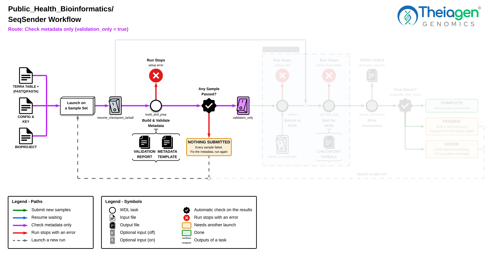
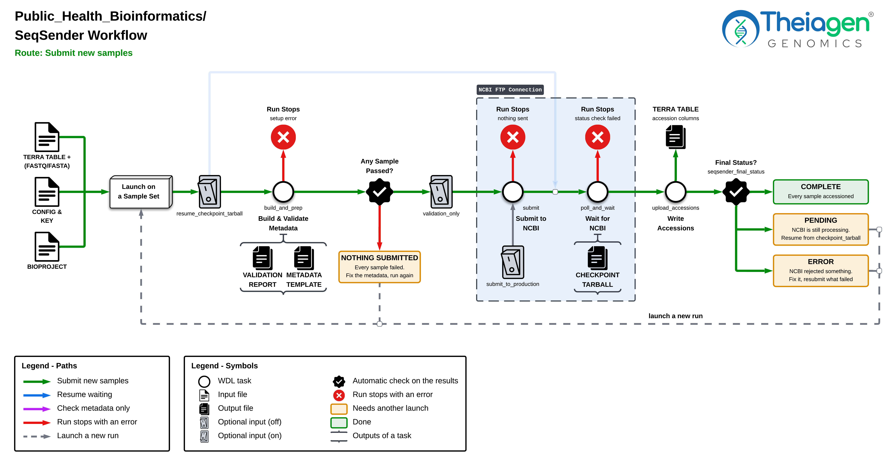
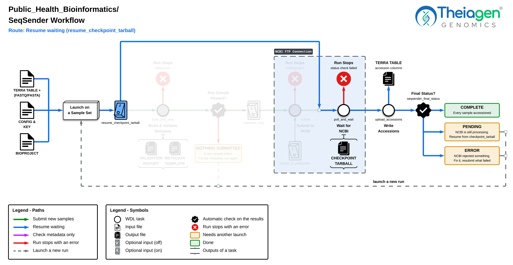

# SeqSender

The [SeqSender](https://github.com/CDCgov/seqsender) workflow sends samples from a Terra table to NCBI's BioSample, SRA and GenBank databases.

## Requirements

1. A config file with your NCBI account credentials and submission details.
2. A Terra table containing your sample information and the metadata required for submission.
3. A Bioproject accession number for your submission.

---

## Workflow Diagram

=== "Validation"

    !!! caption "Repeat until every sample passes"

        

=== "Submission"

    !!! caption "Submits to `BioSample`, `SRA`, and `GenBank` Databases"

        

=== "Polling"

    !!! caption "Depending on the status of each sample, the workflow may need to be re-run to complete submission"

        

---

## Create Your Config File

???+ toggle "Click to expand"

    Inspired by [SeqSender's Submission Wizard](https://cdcgov.github.io/seqsender/), this config builder runs in your browser and can be used to create a config file used in the [SeqSender_PHB](https://dockstore.org/workflows/github.com/theiagen/public_health_bioinformatics/SeqSender_PHB) workflow. It will encrypt your NCBI FTP password and generate a corresponding key which will be required for any subsequent submissions.

    --8<-- "docs/workflows/public_data_sharing/seqsender_config_builder.html"

---

## Launching the Workflow

/// html | div[class="grid cards four-row" markdown]

-   

    [Step 1: Initial Setup](#step-1-initial-setup){ .md-button .md-button--primary }

    

-   

    [Step 2: Validate metadata](#step-2-validate-metadata){ .md-button .md-button--primary }

    

-   

    [Step 3: Submit new samples](#step-3-submit-new-samples){ .md-button .md-button--primary }

    

-   

    [Step 4: Resume submissions](#step-4-resume-submissions){ .md-button .md-button--primary }

    

///

 

=== "Step 1: Initial Setup"

    <h3>Initial Setup</h3>

    1. Export the [SeqSender_PHB](https://dockstore.org/workflows/github.com/theiagen/public_health_bioinformatics/SeqSender_PHB) workflow to your Terra workspace.
    2. Upload the [config file](#create-your-config-file) to your Terra workspace.
    3. Create a [set table](https://support.terra.bio/hc/en-us/articles/4417647037851-When-and-how-to-use-a-set-table-for-a-workflows) with the samples you plan to submit.

        !!! tip "Note"
            This workflow must be launched using a **SET** in your Terra workspace. This **SET** also must be created **PRIOR** to selecting your samples in the "Workflows" tab on Terra.

    4. Open the SeqSender workflow in your Terra workspace and select the **SET** table containing the samples you plan to submit.
    5. Enter the appropriate values into the SeqSender workflow inputs. See table below for the required input parameters specific to this step in the workflow.

    <h3>Inputs Configured</h3>

    /// html | div[class="searchable-table"]

    {{ render_tsv_table("docs/assets/tables/all_inputs.tsv", input_table=True, filters={"Workflow": "SeqSender", "Variable": ["bioproject", "sample_ids", "seqsender_config", "seqsender_key", "seqsender_organism_tag", "submit_to_biosample", "submit_to_genbank", "submit_to_sra", "terra_project_name", "terra_table_name", "terra_workspace_name", "assembly_fastas", "read1_fastqs", "read2_fastqs", "sra_transfer_gcp_bucket"]}, columns=["Terra Task Name", "Variable", "Type", "Description", "Default Value", "Terra Status"], sort_by=[("Terra Status", True), "Terra Task Name", "Variable"], indent=8) }}

    ///

    !!! info "Using `sra_transfer_gcp_bucket`"
        Optional, for SRA only. When set, the workflow copies the passing samples' reads to this bucket and NCBI fetches them from there, instead of the workflow uploading them over FTP. Reads aren't copied when `validation_only` is `true`. The bucket must be readable by NCBI, and the reads must stay in it until SRA is `PROCESSED`. Read files already in the bucket with the same name are **KEPT**, not replaced.

=== "Step 2: Validate metadata"

    <h3>Preparing for Submission</h3>

    The best way to prepare your Terra table for submission is to run the SeqSender workflow in `validation_only` mode. This generates a `validation_metadata_template` output containing all required, database-specific columns for your submission. You can download this template, populate it with the necessary metadata, and re-upload it to your original Terra table to update the submission information.

    1. Open the SeqSender workflow in your Terra workspace and select the **SET** table containing the samples you plan to submit.
    2. Set the `validation_only` parameter to `true`.
    3. Launch the SeqSender workflow.

    <h3>Inputs Configured</h3>

    /// html | div[class="searchable-table"]

    {{ render_tsv_table("docs/assets/tables/all_inputs.tsv", input_table=True, filters={"Workflow": "SeqSender", "Variable": ["validation_only"]}, columns=["Terra Task Name", "Variable", "Type", "Description", "Default Value", "Terra Status"], sort_by=[("Terra Status", True), "Terra Task Name", "Variable"], indent=8) }}

    ///

    <h3>What happens?</h3>
    See the [`Validation`workflow diagram](#validation) above. The workflow pulls the selected rows from your Terra table, builds each sample's submission files, and checks/validates each sample with SeqSender. Nothing gets submitted to NCBI.

    <h3>Next Steps</h3>

    1. After the run is completed, download the `validation_metadata_template` output file, populate it with the necessary information, and re-upload it to your Terra table (Import Data -> Upload TSV).
    2. Re-run the SeqSender workflow in `validation_only` mode to check if all samples now pass validation.
    3. Once completed, review the `validation_samples_passed`, `validation_samples_failed`, and `validation_summary` workflow outputs to understand the status of each sample and what additional metadata is required for submission. These outputs can be found in your **SET** table.
    4. Repeat the process of downloading, populating, and re-uploading the `validation_metadata_template` until all samples pass validation.

    !!! info "Optional Columns"

        The metadata template output file lists only the required columns. To submit additional/optional metadata, add a column to your Terra table with the SeqSender column name, and the workflow passes it along. SeqSender's [metadata templates](https://github.com/CDCgov/seqsender/tree/v1.5.2/shiny/templates) list every column it accepts, with a description of each.

=== "Step 3: Submit new samples"

    <h3>Submitting New Samples</h3>

    Before submitting new samples, ensure that all required metadata has been provided and that the samples have passed validation. A final validation check will be performed automatically by the workflow prior to submission.

    1. Open the SeqSender workflow in your Terra workspace and select the **SET** table containing the samples you plan to submit.
    2. Set the `validation_only` parameter to `false`.
    3. Set the `submit_to_production` parameter to `false` to send to NCBI's test server, or set it to `true` for the real public submission.
    4. Enter any other SeqSender workflow inputs as needed. See table below for key input parameters specific to this step in the workflow.
    4. Launch the SeqSender workflow.

    <h3>Inputs Configured</h3>

    /// html | div[class="searchable-table"]

    {{ render_tsv_table("docs/assets/tables/all_inputs.tsv", input_table=True, filters={"Workflow": "SeqSender", "Variable": ["max_wait_hours", "poll_interval_minutes", "submit_to_production", "validation_only"]}, columns=["Terra Task Name", "Variable", "Type", "Description", "Default Value", "Terra Status"], sort_by=[("Terra Status", True), "Terra Task Name", "Variable"], indent=8) }}

    ///

    !!! info "Choosing `max_wait_hours`"
        NCBI keeps processing your submission whether or not the workflow is running; the workflow only checks on its progress. If `max_wait_hours` runs out before NCBI finishes, the run ends as `PENDING` and you can [resume it](#step-4-resume-submissions) later. There are two ways to wait for NCBI:

        - **One long run**: set `max_wait_hours` high enough for NCBI to finish. If it finishes in time, you won't need to resume, but you pay for the run the whole time it waits.
        - **Several shorter runs**: keep `max_wait_hours` low, and resume with the newest `checkpoint_tarball` until `seqsender_final_status` is `COMPLETE`. Each run costs less, but you relaunch it yourself each time.

    <h3>What happens?</h3>
    See the [`Submission`workflow diagram](#submission) above. When you submit new samples, only samples that pass SeqSender validation checks will proceed to submission. After submitting the samples to NCBI's `Test`/`Production` databases, the workflow will begin polling NCBI every `poll_interval_minutes`, for up to `max_wait_hours`. If you're attempting to submit to all three databases, and your configuration specifies to link `GenBank` to `BioSample` and `SRA` records, the workflow will wait for `BioSample` and `SRA` to be processed before submitting to `GenBank`. Once all submissions are processed, the workflow will update the final status and record the generated accessions to your Terra data table.

    <h3>Next Steps</h3>

    1. After the run is completed, check that `seqsender_final_status` is `COMPLETE`. This means NCBI processed every database you submitted to and every submitted sample received an accession.
    2. Check that the new `biosample_accession`, `sra_accession`, and/or `genbank_accession` columns are populated in your Terra data table. GenBank gives one accession per FASTA record (e.g. one per flu segment), so `genbank_accession` lists each `gb-sample_name` with its accession.
    3. Check the number of `validation_samples_failed`. Any samples marked FAIL in `validation_summary` were left out of the final submission. Fix them as described in [Step 2](#step-2-validate-metadata), then submit them again in a new **SET**.

    !!! tip "Moving from `Test` to `Production`"
        Test submissions (`submit_to_production` = `false`) also write accessions to your Terra table. Clear them before submitting the same samples to production, or validation will fail those samples as already submitted.

    <h3>Final Status</h3>

    ??? info "**If the Terra run failed**"
        Open the failed task in the Job Manager, read its stdout, and look up the error for that task: [`validation`](#validation-errors), [`submission`](#submission-errors), or [`polling`](#polling-errors).

    ??? info "**If `validation_samples_passed` is 0**"
        Nothing was submitted. See the [`validation` sample errors](#validation-errors) and the `validation_summary` output.

    ??? info "**If `seqsender_final_status` is `PENDING`**"
        NCBI didn't finish within `max_wait_hours`. [Resume the submission](#step-4-resume-submissions) instead of relaunching.

    ??? info "**If `seqsender_final_status` is `ERROR`**"
        NCBI rejected at least one database or sample. Next steps include:

        1. Review what NCBI rejected in the `seqsender_submission_status` and `seqsender_report_xml_*` outputs.
        2. Fix those samples' metadata or files in your Terra data table.
        3. Create a new **SET** with only those samples, and relaunch this workflow with `submit_to_*` parameters set to `true` only for the databases that errored. Validation checks will fail if you try to resubmit samples that already have accessions for the selected databases. If `Link_Sample_Between_NCBI_Databases` is on (based on your config file), a new GenBank submission will still be linked to the BioSample and SRA accessions in your table.

=== "Step 4: Resume submissions"

    <h3>Resuming Submissions</h3>

    Resume a submission when `seqsender_final_status` is `PENDING`, or when the run stopped while checking NCBI (a failed `polling` or `upload_accessions` task). Resuming picks up from the earlier run's checkpoint, so samples that were already submitted aren't sent to NCBI again.

    1. Open the SeqSender workflow in your Terra workspace and select the same **SET** as the earlier run, keeping the same required inputs.
    2. Set `resume_checkpoint_tarball` to the earlier run's `checkpoint_tarball` output. If that run failed and has no `checkpoint_tarball`, use the newest checkpoint from its execution directory (see [`polling`](#polling)).
    3. Enter any other SeqSender workflow inputs as needed. See table below for key input parameters specific to this step in the workflow.
    4. Launch the SeqSender workflow.

    <h3>Inputs Configured</h3>

    /// html | div[class="searchable-table"]

    {{ render_tsv_table("docs/assets/tables/all_inputs.tsv", input_table=True, filters={"Workflow": "SeqSender", "Variable": ["max_wait_hours", "poll_interval_minutes", "validation_only", "resume_checkpoint_tarball"]}, columns=["Terra Task Name", "Variable", "Type", "Description", "Default Value", "Terra Status"], sort_by=[("Terra Status", True), "Terra Task Name", "Variable"], indent=8) }}

    ///

    <h3>What happens?</h3>
    See the [`Polling` workflow diagram](#workflow-diagram) above. The `validation` and `submission` tasks are skipped, and the workflow checks NCBI every `poll_interval_minutes`, for up to `max_wait_hours`. A GenBank submission still waiting on `BioSample` and `SRA` is sent once they're processed. When it's done, the workflow records the final status and writes the accessions to your Terra table.

    <h3>Next Steps</h3>
    After the run is completed:

    1. Check that `seqsender_final_status` is `COMPLETE` and that your sample table has the new accessions, as in [Step 3](#step-3-submit-new-samples).
    2. If it's still `PENDING`, resume again with this run's `checkpoint_tarball`. Each resumed run writes a new one, so always use the latest/newest `checkpoint_tarball` output.

 

---

## Troubleshooting Errors

??? toggle "`validation` task"

    

    ??? warning "Input Errors"
        | Error Message | Recommended Actions |
        | :--- | :--- |
        | `ERROR: choose at least one of --biosample, --sra or --genbank` | Set at least one of `submit_to_biosample`, `submit_to_sra` or `submit_to_genbank` to `true`. |
        | `ERROR: --read1_fastqs is required for SRA submission` | Provide `read1_fastqs` (plus `read2_fastqs` for paired-end reads), or set `submit_to_sra` to `false`. |
        | `ERROR: --assembly_fastas is required for GenBank submission` | Provide `assembly_fastas`, or set `submit_to_genbank` to `false`. |
        | `ERROR: GenBank submission is only supported for FLU and COV, not <organism>` | Set `submit_to_genbank` to `false`. GenBank submission is only available when `seqsender_organism_tag` is `FLU` or `COV`. |
        | `ERROR: --sra_transfer_bucket must be a gs:// bucket, not <bucket>` | Give `sra_transfer_gcp_bucket` as a full `gs://` path, e.g. `gs://<bucket>/<folder>`. |
        | `ERROR: <n> <files> given for <n> sample_ids; they must be the same length and order` | Make sure `assembly_fastas`, `read1_fastqs` and `read2_fastqs` each have one file per sample. Run single-end and paired-end samples in separate sets. |
        | `ERROR: read files must have unique names; repeated: <names>` | Rename the listed read files so every file name in the set is unique. |
        | `ERROR: seqsender has no metadata template <file>; check BioSample_Package in the config file` | Set `BioSample_Package` in the config file to a package SeqSender supports, e.g. `Pathogen.cl.1.0`. |

    ??? warning "Sample Errors"

        | Error Message | Recommended Actions |
        | :--- | :--- |
        | `fill in or clear the metadata template's '<description>' text in: <columns>` | Replace the `<...>` text in the listed columns with the sample's values, then upload the updated table to Terra. |
        | `already has <accession columns>; turn off <submit_to_* inputs>` | Set the listed `submit_to_*` inputs to `false` to submit the sample to the other databases only. If the accession is wrong, e.g. from a test submission, clear it in your Terra table first. |
        | `Organism '<organism>' isn't accepted for GenBank flu submissions; ...` | Set the sample's `organism` column to `Influenza A virus`, `Influenza B virus` or `Influenza C virus`. |
        | `assembly FASTA is empty or has an empty sequence` | Check the sample's `assembly_fasta`, and replace it with one where every record has a sequence. |

    ??? warning "Other Errors"
        These stop the task with a non-zero exit instead of a specific `ERROR:` message:

        | Errors | Recommended Actions |
        | :--- | :--- |
        | **Errors from `bioforklift download`** | Double check the `terra_project_name`, `terra_workspace_name` and `terra_table_name` are correct and that the table holds the selected samples. |
        | **`KeyError: 'entity:<table>_id'`** | Double check the `terra_table_name` is accurate and holds the selected samples. |
        | **Google Cloud errors such as `403 Forbidden` or `404 Not Found` while copying reads** | Check the `sra_transfer_gcp_bucket` name, and give your Terra proxy group write access to the bucket. |
        | **`No space left on device`** | Raise `disk_size` for this task (25 GB by default). Without a `sra_transfer_gcp_bucket`, the reads are transferred via FTP locally, and the task needs about twice the total size of the reads. |

??? toggle "`submission` task"

    

    ??? warning "Input Errors"

        This task doesn't fail as along as at least one database submission was successful. The run goes on to check the databases that were sent, the others get no accessions, and `seqsender_final_status` ends as `ERROR`.

        | Error Message | Recommended Actions |
            | :--- | :--- |
            | `ERROR: seqsender submit failed before anything was submitted; see seqsender_submit.log` | Fix the SeqSender error printed just above this message (see the causes below), then relaunch. Nothing was sent to NCBI, so relaunching is safe. |

        **Potential Causes:**

        - **An `InvalidToken` traceback**: `seqsender_key` isn't the key that encrypted this config file's password. If it also says `Passwords field does not appear to be encrypted`, the config file holds a plain password; rebuild it with the config builder above.
        - **`Error: login error. Possible incorrect credentials for NCBI FTP site`**: the NCBI FTP username or password is wrong, e.g. the password changed after the config file was built.
        - **`Error unable to connect to FTP site`**: NCBI's FTP server couldn't be reached. Try again later.
        - **Samples fail set level validation**: Samples are individually checked during the `validation` task, but the `submit` task checks them all together as a set. This can catch conflicts between samples if they share the same `bs-sample_name`, `sra-sample_name`, `gb-sample_name`, or FASTA `sequence_name`. Each name must be unique across the set.

??? toggle "`polling` task"

    

    ??? warning "Input Errors"

        | Error Message | Recommended Actions |
        | :--- | :--- |
        | `ERROR: .../submission_log.csv not found; this state hasn't been submitted` | Set `resume_checkpoint_tarball` to the `checkpoint_tarball` output of a run that submitted samples. |
        | `ERROR: <path> from submission_log.csv doesn't exist` | Use the original `checkpoint_tarball` output; this one is incomplete or was changed. |
        | `ERROR: --key doesn't decrypt the NCBI password in config.yaml; use the key that encrypted it` | Set `seqsender_key` to the key used when these samples were submitted. |
        | `ERROR: seqsender submission_status failed; see the seqsender output in the log` | Read the lines starting with `seqsender:` just above this message, fix the cause, then resume with the newest checkpoint. |

        After this task fails, the run has no `checkpoint_tarball` output. Open the run's execution directory from the Job Manager and use the newest checkpoint for `resume_checkpoint_tarball`: `call-polling/.../seqsender_post_polling_checkpoint.tar.gz` if it's there, otherwise `call-submission/.../seqsender_post_submission_checkpoint.tar.gz`. Prefer the polling one, since the submission one is from before the wait, so resuming from it may send GenBank again.

