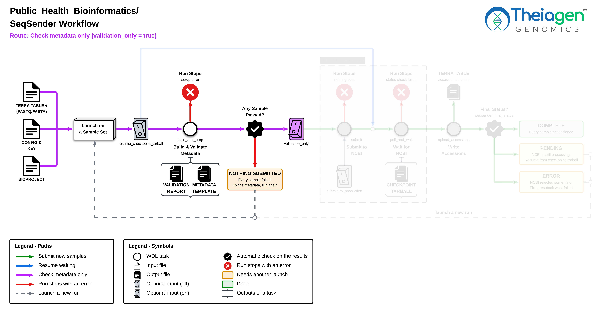
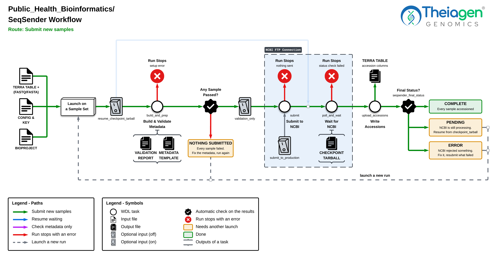
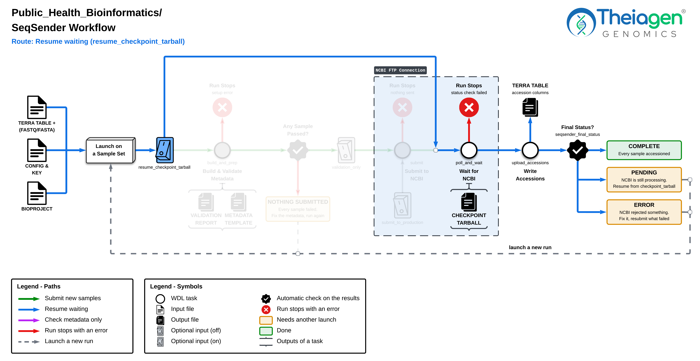

# SeqSender

## Quick Facts

{{ render_tsv_table("docs/assets/tables/all_workflows.tsv", sort_by="Name", filters={"Name": "[**SeqSender**](../workflows/public_data_sharing/seqsender.md)"}, columns=["Workflow Type", "Applicable Kingdom", "Last Known Changes", "Command-line Compatibility","Workflow Level", "Dockstore"]) }}

The SeqSender workflow uses the CDC's [SeqSender](https://github.com/CDCgov/seqsender) tool to send samples from a Terra table to NCBI's BioSample, SRA and GenBank databases.

## Requirements

1. A config file with your NCBI FTP account credentials and submission details.
2. A Terra table containing your sample information and the metadata required for submission.
3. A BioProject accession number for your submission.

---

## Workflow Diagram

=== "Validation"

    !!! caption "Repeat until every sample passes"

        

=== "Submission"

    !!! caption "Submits to `BioSample`, `SRA`, and `GenBank` Databases"

        

=== "Polling"

    !!! caption "Depending on the status of each sample, the workflow may need to be re-run to complete submission"

        

---

## Create Your Config File

???+ toggle "Click to expand"

    !!! info "Local Config Builder"
        Nothing entered in this form, including your NCBI FTP password, is saved or uploaded anywhere. This config is generated entirely in your browser, so once this page has loaded, you can create it completely offline.

    Inspired by [SeqSender's Submission Wizard](https://cdcgov.github.io/seqsender/), this config builder runs in your browser and can be used to create a config file used in the [SeqSender_PHB](https://dockstore.org/workflows/github.com/theiagen/public_health_bioinformatics/SeqSender_PHB) workflow. It will encrypt your NCBI FTP password and generate a corresponding key which will be **required for any subsequent submissions**.

    --8<-- "docs/workflows/public_data_sharing/seqsender_config_builder.html"

---

## Launching the Workflow

!!! warning "Influenza only"
    This workflow currently supports **Influenza** samples only.

!!! caption ""
    === "Step 1: Initial Setup"

        <h2>Initial Setup</h2>

        1. Export the [SeqSender_PHB](https://dockstore.org/workflows/github.com/theiagen/public_health_bioinformatics/SeqSender_PHB) workflow to your Terra workspace.
        2. Upload the [config file](#create-your-config-file) to your Terra workspace.
        3. Create a [set table](https://support.terra.bio/hc/en-us/articles/4417647037851-When-and-how-to-use-a-set-table-for-a-workflows) with the samples you plan to submit.
        4. Open the SeqSender workflow in your Terra workspace and select the **SET** table containing the samples you plan to submit.
        5. Enter the appropriate values into the SeqSender workflow inputs. See table below for the required input parameters specific to this step in the workflow.

        !!! tip "SeqSender requires *preexisting* sets"
            This workflow must be launched using a *preexisting* SET in your Terra workspace. The **SET** must be created **BEFORE** sample selection during workflow configuration.

        <h2>Inputs Configured</h2>

        /// html | div[class="searchable-table"]

        {{ render_tsv_table("docs/assets/tables/all_inputs.tsv", input_table=True, filters={"Workflow": "SeqSender", "Variable": ["bioproject", "sample_ids", "seqsender_config", "seqsender_key", "seqsender_organism_tag", "submit_to_biosample", "submit_to_genbank", "submit_to_sra", "terra_project_name", "terra_table_name", "terra_workspace_name", "assembly_fastas", "read1_fastqs", "read2_fastqs", "sra_transfer_gcp_bucket"]}, columns=["Terra Task Name", "Variable", "Type", "Description", "Default Value", "Terra Status"], sort_by=[("Terra Status", True), "Terra Task Name", "Variable"], indent=12) }}

        ///

        !!! tip "Filling in `terra_table_name`"
            The `terra_table_name` input is the name of your **sample** table (e.g. `sample`), not the **SET** table (e.g. `sample_set`).

        !!! info "Using `sra_transfer_gcp_bucket`"
            Optional, for SRA only. When set, the workflow copies the passing samples' reads to this bucket and NCBI fetches them from there, instead of the workflow uploading them over FTP. The bucket must be readable by NCBI, and the reads must stay in it until SRA is `PROCESSED`. Read files already in the bucket with the same name are **KEPT**, not replaced. Reads aren't copied when `validation_only` is `true`.

            **Contact Theiagen to request access to our `gs://theiagen_sra_transfer` GCP bucket.**

        

        [Back to top](#step-1-initial-setup) &nbsp;|&nbsp; [Next: Step 2 :material-arrow-right:](#step-2-validate-metadata)

        

    === "Step 2: Validate metadata"

        <h2>Preparing for Submission</h2>

        The best way to prepare your Terra table for submission is to run the SeqSender workflow in `validation_only` mode. This generates a `validation_metadata_template` output containing all required, database-specific columns for your submission. You can download this template, populate it with the necessary metadata, and re-upload it to your original Terra table to update the submission information.

        1. Open the SeqSender workflow in your Terra workspace and select the **SET** table containing the samples you plan to submit.
        2. Set the `validation_only` parameter to `true`.
        3. Launch the SeqSender workflow.

        <h2>Inputs Configured</h2>

        /// html | div[class="searchable-table"]

        {{ render_tsv_table("docs/assets/tables/all_inputs.tsv", input_table=True, filters={"Workflow": "SeqSender", "Variable": ["validation_only"]}, columns=["Terra Task Name", "Variable", "Type", "Description", "Default Value", "Terra Status"], sort_by=[("Terra Status", True), "Terra Task Name", "Variable"], indent=12) }}

        ///

        <h2>What happens?</h2>
        See the [`Validation`workflow diagram](#validation) above. The workflow retrieves the selected rows from your Terra table, generates the submission files for each sample, and runs each sample through SeqSender for validation. Nothing gets submitted to NCBI.

        <h2>Next Steps</h2>

        1. After the run is completed, download the `validation_metadata_template` output file and fill in the required metadata columns using the bracketed descriptions as guidance. Then re-upload the completed file to your Terra table (Import Data -> Upload TSV).
        2. Re-run the SeqSender workflow in `validation_only` mode to check if all samples now pass validation.
        3. Once completed, review the `validation_samples_passed`, `validation_samples_failed`, and `validation_summary` workflow outputs to understand the status of each sample and what additional metadata is required for submission. These outputs can be found in your **SET** table.
        4. Repeat the process of downloading, populating, and re-uploading the `validation_metadata_template` until all samples pass validation.

        !!! tip "Submitting influenza to GenBank?"
            NCBI runs extra checks on GenBank submissions after they're sent, which validation can't catch. Check your metadata against [Avoiding GenBank Discrepancies](#avoiding-genbank-discrepancies) before you submit.

        !!! info "One error per sample, per run"
            Validation stops at the first check a sample fails, so the `validation_summary` may not list all of a sample's problems at once. After you fix one, rerun the validation again to ensure all issues are resolved.

        !!! info "Optional Columns"
            The metadata template output file lists only the **required** columns. To submit additional optional metadata, add a column to your Terra table with the corresponding SeqSender column name. The workflow will pass it along automatically. SeqSender's [metadata templates](https://github.com/CDCgov/seqsender/tree/v1.5.2/shiny/templates) list all accepted columns and their descriptions.

        

        [Back to top](#step-2-validate-metadata) &nbsp;|&nbsp; [Next: Step 3 :material-arrow-right:](#step-3-submit-new-samples)

        

    === "Step 3: Submit new samples"

        <h2>Submitting New Samples</h2>

        Before submitting new samples, ensure that all required metadata has been provided and that the samples have passed validation. A final validation check will be performed automatically by the workflow prior to submission.

        1. Open the SeqSender workflow in your Terra workspace and select the **SET** table containing the samples you plan to submit.
        2. Set the `validation_only` parameter to `false`.
        3. Set the `submit_to_production` parameter to `false` to send to NCBI's test server, or set it to `true` for the real public submission.
        4. Enter any other SeqSender workflow inputs as needed. See table below for key input parameters specific to this step in the workflow.
        5. Launch the SeqSender workflow.

        <h2>Inputs Configured</h2>

        /// html | div[class="searchable-table"]

        {{ render_tsv_table("docs/assets/tables/all_inputs.tsv", input_table=True, filters={"Workflow": "SeqSender", "Variable": ["max_wait_hours", "poll_interval_minutes", "submit_to_production", "validation_only"]}, columns=["Terra Task Name", "Variable", "Type", "Description", "Default Value", "Terra Status"], sort_by=[("Terra Status", True), "Terra Task Name", "Variable"], indent=12) }}

        ///

        !!! info "Choosing `max_wait_hours`"
            NCBI keeps processing your submission whether or not the workflow is running; the workflow only checks on its progress. If `max_wait_hours` runs out before NCBI finishes, the run ends as `PENDING` and you can [resume it](#step-4-resume-submissions) later. There are two ways to wait for NCBI:

            - **One long run**: set `max_wait_hours` high enough for NCBI to finish. If it finishes in time, you won't need to resume, but you pay for the run the whole time it waits.
            - **Several shorter runs**: keep `max_wait_hours` low, and resume with the newest `checkpoint_tarball` until `seqsender_final_status` is `COMPLETE`. Each run costs less, but you relaunch it yourself each time.

        <h2>What happens?</h2>
        See the [`Submission`workflow diagram](#submission) above. Only samples that pass SeqSender's validation checks will proceed to submission. Once submitted to NCBI's `Test` or `Production` database, the workflow will poll NCBI every `poll_interval_minutes`, for up to `max_wait_hours`.

        If GenBank linking is enabled (set in the config file) and you submit to `GenBank` together with `BioSample` and/or `SRA`, the workflow will wait for those submissions to finish processing before submitting to `GenBank`.

        Once processing is complete, the workflow will update the final submission statuses and, for `Production` submissions, write the generated accessions back to your Terra data table.

        <h2>Next Steps</h2>

        1. After the run is completed, check that `seqsender_final_status` is `COMPLETE`. This means NCBI processed every database you submitted to and every submitted sample received an accession.
        2. For production submissions, check that the new `biosample_accession`, `sra_accession`, and/or `genbank_accession` columns are populated in your Terra data table. GenBank gives one accession per FASTA record (e.g. one per flu segment), so `genbank_accession` lists each `gb-sample_name` with its accession. For test submissions, accessions do not get repopulated to your Terra data table. Instead, check that NCBI's placeholder accessions are listed in the corresponding `seqsender_report_xml_*` outputs.
        3. Check the number of `validation_samples_failed`. Any samples marked FAIL in `validation_summary` were left out of the final submission. Fix them as described in [Step 2](#step-2-validate-metadata), then submit them again in a new **SET**.

        !!! tip "Moving from `Test` to `Production`"
            Test submissions (`submit_to_production` = `false`) don't write accessions to your Terra table, so you can submit the same samples to production without changing it. Check `seqsender_submission_type` to see which kind of submission a run made.

        <h2>Final Status</h2>

        ??? info "**If the Terra run failed**"
            Open the failed task in the Job Manager. The `ERROR:` message is at the end of its **stderr**, and SeqSender's own messages are in its **stdout**. Look it up in [Troubleshooting](#troubleshooting) by searching the task's name or a few words from the error message.

        ??? info "**If `validation_samples_passed` is 0**"
            Nothing was submitted. Each sample's `reason` in the `validation_summary` output says what to fix. See [Step 2](#step-2-validate-metadata) and [Troubleshooting](#troubleshooting).

        ??? info "**If `seqsender_final_status` is `PENDING`**"
            NCBI didn't finish within `max_wait_hours`. [Resume the submission](#step-4-resume-submissions) instead of relaunching.

        ??? info "**If `seqsender_final_status` is `ERROR`**"
            NCBI rejected at least one database or sample. Next steps include:

            1. Review what NCBI rejected in the `seqsender_database_statuses`, `seqsender_submission_status_report` and `seqsender_report_xml_*` outputs. For GenBank submissions, see [Avoiding GenBank Discrepancies](#avoiding-genbank-discrepancies).
            2. Fix those samples' metadata or files in your Terra data table.
            3. Create a new **SET** with only those samples, and relaunch this workflow with `submit_to_*` parameters set to `true` only for the databases that errored. Validation checks will fail if you try to resubmit samples that already have accessions for the selected databases. If `Link_Sample_Between_NCBI_Databases` is on (based on your config file), a new GenBank submission will still be linked to the BioSample and SRA accessions in your table.

        

        [Back to top](#step-3-submit-new-samples) &nbsp;|&nbsp; [Next: Step 4 :material-arrow-right:](#step-4-resume-submissions)

        

    === "Step 4: Resume submissions"

        <h2>Resuming Submissions</h2>

        Resume a submission when `seqsender_final_status` is `PENDING`, or if the run stopped while checking NCBI (a failed `polling` or `seqsender_upload_accessions` task). Resuming picks up from the earlier run's checkpoint, so samples that were already submitted aren't sent to NCBI again.

        1. Open the SeqSender workflow in your Terra workspace and select the same **SET** as the earlier run, keeping the same required inputs.
        2. Set `resume_checkpoint_tarball` to the earlier run's `checkpoint_tarball` output. If that run failed and has no `checkpoint_tarball`, use the newest checkpoint from its execution directory.
        3. Enter any other SeqSender workflow inputs as needed. See table below for key input parameters specific to this step in the workflow.
        4. Launch the SeqSender workflow.

        <h2>Inputs Configured</h2>

        /// html | div[class="searchable-table"]

        {{ render_tsv_table("docs/assets/tables/all_inputs.tsv", input_table=True, filters={"Workflow": "SeqSender", "Variable": ["max_wait_hours", "poll_interval_minutes", "validation_only", "resume_checkpoint_tarball"]}, columns=["Terra Task Name", "Variable", "Type", "Description", "Default Value", "Terra Status"], sort_by=[("Terra Status", True), "Terra Task Name", "Variable"], indent=12) }}

        ///

        <h2>What happens?</h2>
        See the [`Polling` workflow diagram](#polling) above. The `validation` and `submission` tasks are skipped, and the workflow checks NCBI every `poll_interval_minutes`, for up to `max_wait_hours`. A GenBank submission still waiting on `BioSample` and `SRA` is sent once they're processed. When it's done, the workflow records the final status and, for `Production` submissions, writes the accessions to your Terra table.

        <h2>Next Steps</h2>
        After the run is completed:

        1. Check that `seqsender_final_status` is `COMPLETE` and that your sample table has the new accessions, as in [Step 3](#step-3-submit-new-samples).
        2. If it's still `PENDING`, resume again with this run's `checkpoint_tarball`. Each resumed run writes a new one, so always use the latest/newest `checkpoint_tarball` output.

        

        [Back to top](#step-4-resume-submissions)

        

 

---

## Avoiding GenBank Discrepancies

NCBI reviews all incoming GenBank submissions. If a submission is rejected, `seqsender_final_status` ends as `ERROR` and the `seqsender_report_xml_genbank` output only indicates `processed-error`. NCBI emails the submitter a detailed report outlining the identified discrepancies. Below are some common metadata issues to check before submitting.

??? toggle "Click to expand"

    ??? warning "Influenza checks"
        | DISCREPANCY TYPE | What NCBI checks | How to avoid it |
        | :--- | :--- | :--- |
        | `INFLUENZA_DATE_MISMATCH` | The year at the end of the strain name doesn't match the year of the collection date. A 2-digit year (e.g. `A/California/07/09`) or a missing collection date also counts as a mismatch. | End `src-Strain` with the same 4-digit year as `collection_date`, e.g. `A/California/W70246/2016` with `2016-12-22`. |
        | `INFLUENZA_QUALS` | The strain, host, country or collection date is missing. | Fill in `src-Strain`, `src-Host`, `src-geo_loc_name` and `collection_date`. SeqSender already requires these. |
        | `INFLUENZA_SEROTYPE` | An Influenza A sample has no serotype. | Fill in `src-Serotype` for every Influenza A sample. The workflow's validation already requires it. |
        | `INFLUENZA_SEROTYPE_FORMAT` | The serotype isn't `H<n>`, `N<n>`, `H<n>N<n>` or `mixed`. | Use uppercase with no spaces or extra text, e.g. `H3N2` or `H1N1` (not `h3n2` or `H3N2 (swine)`). |

    ??? warning "Other source checks"
        | DISCREPANCY TYPE | What NCBI checks | How to avoid it |
        | :--- | :--- | :--- |
        | `COUNTRY_COLON`, `END_COLON_IN_COUNTRY` | `src-geo_loc_name` has more than one colon, or ends with one. | Use `Country` or `Country: region`, e.g. `USA: California`. |
        | `HUMAN_HOST` | The host contains the word "human". | Use `Homo sapiens` in `src-Host`. |
        | `MULTISRC` | The strain or isolate contains a comma or semicolon. | Remove commas and semicolons from `src-Strain` and `src-Isolate`. |
        | `DUP_SRC_QUAL` | Two different source fields have the same value. | Don't copy one field into another, e.g. `src-Isolate` shouldn't repeat `src-Strain`. |
        | `STRAIN_TAXNAME_MISMATCH` | Sequences with the same strain have different organisms. | Give every segment of a strain the same `organism`. |

    Source: NCBI C++ Toolkit, [`biosource_tests.cpp`](https://github.com/ncbi/ncbi-cxx-toolkit-public/blob/master/src/misc/discrepancy/biosource_tests.cpp).

## Troubleshooting

Paste part or all of an error message in the search box below to find its recommended action. Alternatively, search by task name (e.g. `validation`, `submission`, `polling`) to browse possible errors.

/// html | div[class="searchable-table search-reveal"]

| Task | Error Message | Recommended Action |
| :--- | :--- | :--- |
| `validation` | `No tables match '<table>' in the Terra workspace` | Set `terra_table_name` to the name of your **sample** table (e.g. `sample`), not the **SET** table (e.g. `sample_set`). Also double check `terra_project_name` and `terra_workspace_name`. |
| `validation` | `Samples [<samples>] not found in the '<column>' column` | The samples in the **SET** aren't in the `terra_table_name` table. Set `terra_table_name` to the table the samples come from. |
| `validation` | `choose at least one of --biosample, --sra or --genbank` | Set at least one of `submit_to_biosample`, `submit_to_sra` or `submit_to_genbank` to `true`. |
| `validation` | `--read1_fastqs is required for SRA submission` | Provide `read1_fastqs` (plus `read2_fastqs` for paired-end reads), or set `submit_to_sra` to `false`. |
| `validation` | `--assembly_fastas is required for GenBank submission` | Provide `assembly_fastas`, or set `submit_to_genbank` to `false`. |
| `validation` | `GenBank submission is only supported for --seqsender_organism_tag FLU and COV, not <organism>` | Set `submit_to_genbank` to `false`. |
| `validation` | `--sra_transfer_bucket must be a gs:// bucket, not <bucket>` | Give `sra_transfer_gcp_bucket` as a full `gs://` path, e.g. `gs://<bucket>/<folder>`. |
| `validation` | `<n> <files> given for <n> sample_ids; they must be the same length and order` | Make sure `assembly_fastas`, `read1_fastqs` and `read2_fastqs` each have one file per sample. Run single-end and paired-end samples in separate sets. |
| `validation` | `read files must have unique names; repeated: <names>` | Rename the listed read files so every file name in the **SET** is unique. |
| `validation` | `seqsender has no metadata template <file>; check BioSample_Package in the config file` | Rebuild the config file with a BioSample package SeqSender supports, e.g. `Pathogen.cl.1.0`. |
| `validation` | `Config file is not properly setup` | The config file's password isn't encrypted, or a field is missing or invalid. Rebuild it with the [config builder](#create-your-config-file). |
| `validation` | `the samples that passed on their own fail seqsender prep together: <errors>` | The samples pass one at a time but conflict as a **SET**, usually because two share a `bs-sample_name`, `sra-sample_name`, or FASTA header (which becomes the `gb-sample_name`). Each must be unique across the **SET**. |
| `validation` | `fill in or clear the metadata template's '<description>' text in: <columns>` | Replace the `<...>` text in the listed columns with the sample's values, then upload the updated table to Terra. |
| `validation` | `already has <accession columns>; turn off <submit_to_* inputs>` | Set the listed `submit_to_*` inputs to `false` to submit the sample to the other databases only. If the accession is wrong, clear it in your Terra table first. |
| `validation` | `Organism '<organism>' isn't accepted for GenBank flu submissions` | Set the sample's `organism` column to `Influenza A virus`, `Influenza B virus` or `Influenza C virus`. |
| `validation` | `NCBI requires <columns> for '<organism>' submissions to GenBank` | Fill in the listed columns: `src-Isolation-source` for every flu sample, and `src-Serotype` (e.g. `H3N2`) for Influenza A. |
| `validation` | `assembly FASTA is empty or has an empty sequence` | Check the sample's `assembly_fasta`, and replace it with one where every record has a sequence. |
| `validation` | `assembly FASTA can't be read` | Replace the sample's `assembly_fasta` with a valid FASTA file. |
| `validation` | `Column '<column>' ...` | One of SeqSender's own metadata checks failed. Fix the named column in your Terra table; SeqSender's [metadata templates](https://github.com/CDCgov/seqsender/tree/v1.5.2/shiny/templates) describe what each column accepts. |
| `validation` | `Forbidden: 403`, `NotFound: 404` | The reads couldn't be copied to the bucket. Check the `sra_transfer_gcp_bucket` name, and give your Terra proxy group write access to the bucket. |
| `validation` | `No space left on device` | Raise `disk_size` for this task (25 GB by default). Without a `sra_transfer_gcp_bucket`, the task needs about twice the total size of the reads. |
| `submission` | `seqsender submit failed before anything was submitted; see seqsender_submit.log` | Nothing was sent to NCBI, so relaunching is safe. Find the cause in this task's **stdout** and search for it here. |
| `submission`, `polling` | `InvalidToken`, `endswith first arg must be bytes` | `seqsender_key` isn't the key that encrypted this config file's password. Use the original key; for a new submission, you can also rebuild the config file. |
| `submission`, `polling` | `Fernet key must be 32 url-safe base64-encoded bytes` | `seqsender_key` is mistyped or incomplete. A key is 44 characters long and ends with `=`. |
| `submission` | `login error. Possible incorrect credentials for NCBI FTP site` | The NCBI FTP username or password is wrong, e.g. the password changed after the config file was built. Rebuild the config file, entering your current key as the **Existing key** to keep using it. |
| `submission` | `Error unable to connect to FTP site` | NCBI's FTP server couldn't be reached. Try again later. |
| `submission` | `No space left on device` | Raise `disk_size` for this task (100 GB by default). |
| `polling` | `submission_log.csv not found; this state hasn't been submitted` | Set `resume_checkpoint_tarball` to the `checkpoint_tarball` output of a run that submitted samples. |
| `polling` | `seqsender submission_status failed; see the seqsender output in the log` | Read the lines starting with `seqsender:` in this task's **stdout**, fix the cause, then resume with the newest checkpoint (see Step 4). |
| `polling` | `<path> from submission_log.csv doesn't exist` | Use the original `checkpoint_tarball` output; this one is incomplete or was changed. |
| `seqsender_upload_accessions` | Any error | Check that `terra_project_name` and `terra_workspace_name` are correct, then resume the submission (see Step 4). The workflow checks NCBI again and uploads the accessions. |

///
